# 🚀 Auto Job Apply AI

> **Universal Autonomous AI-Powered Job Application Engine & Multi-Channel Recruiter Outreach Suite**
> 
> *Drop job screenshots into a folder or import custom CSV files → AI extracts job requirements & recruiter contacts → Generates tailored, human-sounding cold emails & WhatsApp pitches matched to your persona and PDF resume → Dispatches automatically with resume attachments, duplicate protection, daily rate throttling, and smart follow-up reminders.*

<p align="center">
  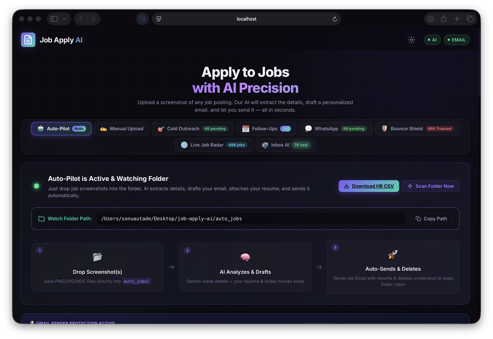
</p>

---

## 📸 Application Visual Tour & Walkthrough

Explore the core user interface and autonomous automation capabilities:

### 1. 🤖 Autonomous Auto-Pilot Watcher & Command Center
> Drop single or multi-part job screenshots directly into the local `auto_jobs/` directory. The event watcher triggers real-time Gemini AI extraction, candidate-resume matching, and outbound dispatch without a single click.

<p align="center">
  
</p>

---

### 2. ✍️ Manual Screenshot Analysis & Tailored Cold Email Drafter
> Drag and drop job posting screenshots for instant preview. Gemini Vision inspects the image, pinpoints recruiter details, extracts core requirements, and synthesizes an anti-AI, human-crafted pitch referencing your specific PDF resume achievements.

<p align="center">
  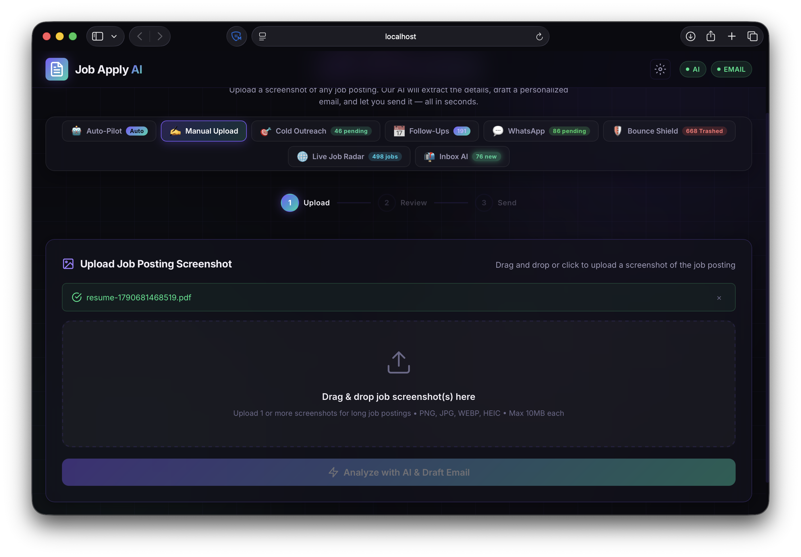
</p>

---

### 3. 📤 High-Volume Cold Email Outreach Campaign Engine
> Execute curated or custom high-volume outreach with built-in daily quota guards, natural anti-spam jitter, and real-time SSE progress tracking.

<p align="center">
  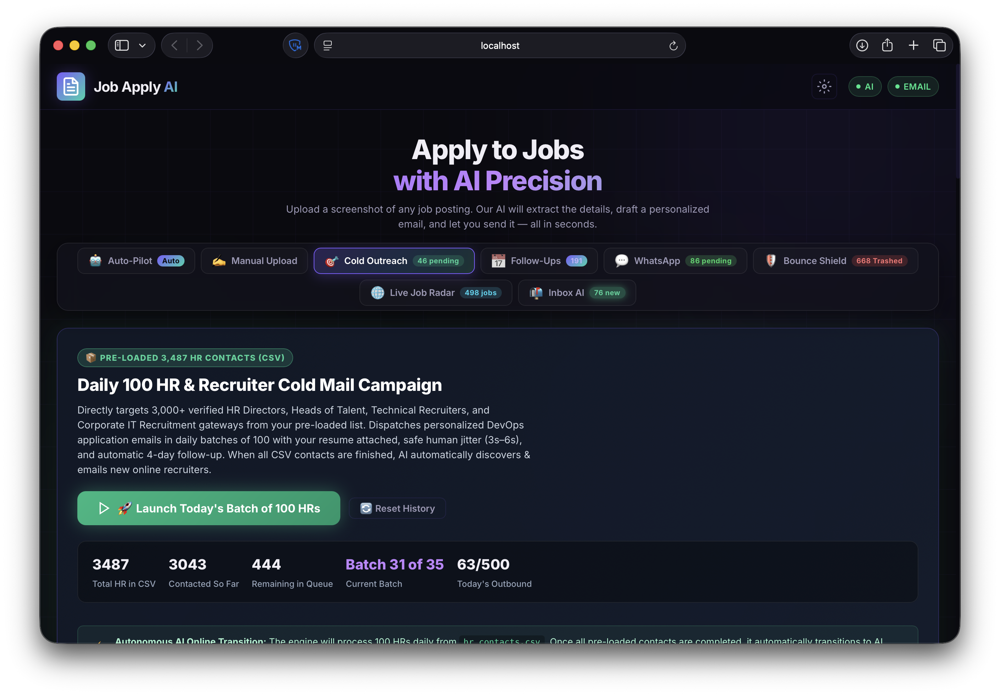
</p>

---

### 4. 📁 Universal Custom CSV Importer & Multimodal Image OCR
> Seamlessly import recruiter databases from any custom CSV file with automatic column mapping, or extract contacts straight from raw screenshots and email lists via Gemini Vision OCR.

<p align="center">
  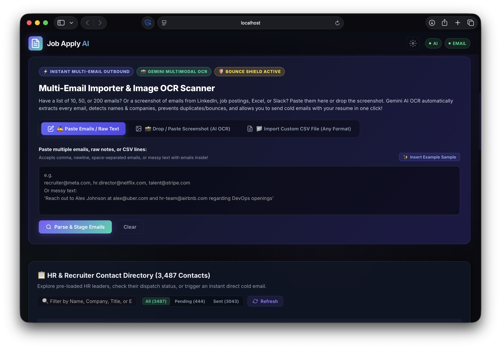
</p>

---

### 5. 📬 Two-Way Inbox Intelligence & Recruiter Sentiment Radar
> Direct Gmail IMAP listener scans recruiter responses to your cold outreach. AI categorizes sentiment (Interview Invite, Positive Interest, Info Request, Rejection, OOO), plays real-time audio alerts, and automatically stops follow-up cadences.

<p align="center">
  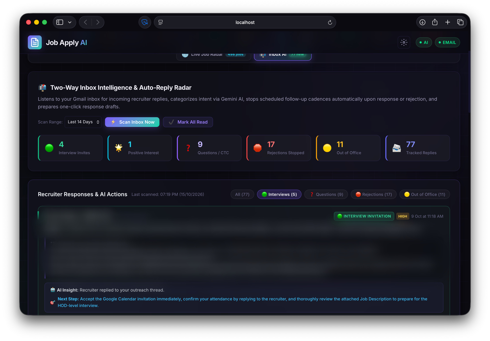
</p>

---

### 6. ⏱️ Smart 4-Day Follow-Up Cadence with Manual Approval
> Keep opportunities warm with automated multi-touch follow-ups. Every scheduled follow-up draft requires 1-click manual approval before dispatch, guaranteeing complete oversight.

<p align="center">
  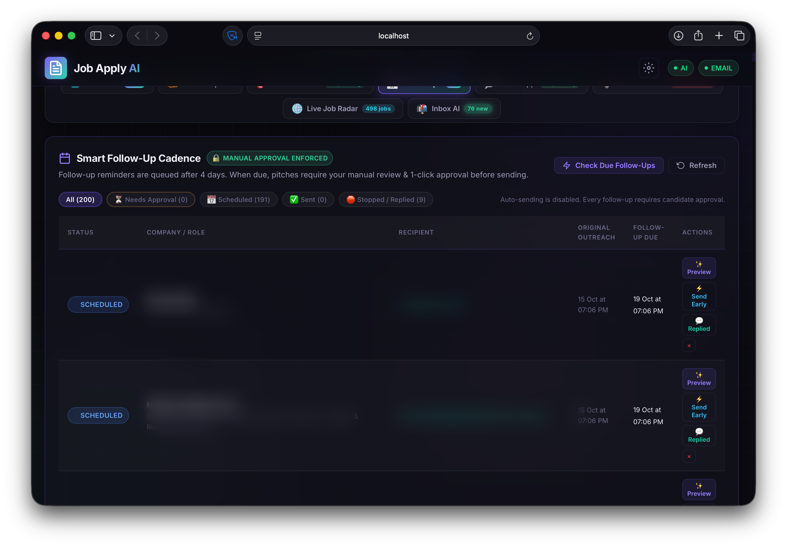
</p>

---

### 7. 🛡️ Delivery & Bounce Shield
> Automatically cleans contact lists by detecting IMAP bounce notifications (`550 User unknown`, `Mailbox unavailable`) and marking invalid addresses as DEAD to safeguard your sender domain reputation.

<p align="center">
  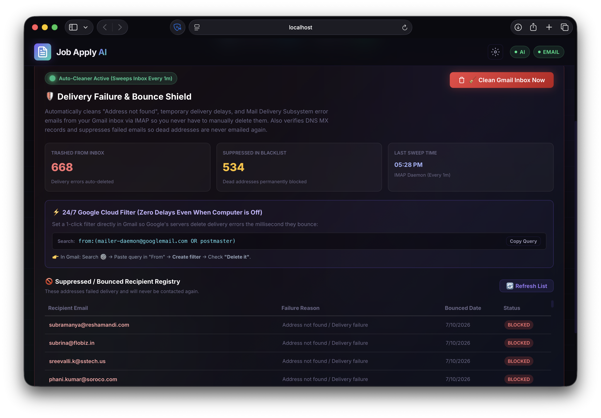
</p>

---

### 8. 🌐 Live ATS Job Radar (Greenhouse, Ashby, Lever)
> Real-time crawler monitoring top tech company career boards to catch newly opened positions the moment they are posted.

<p align="center">
  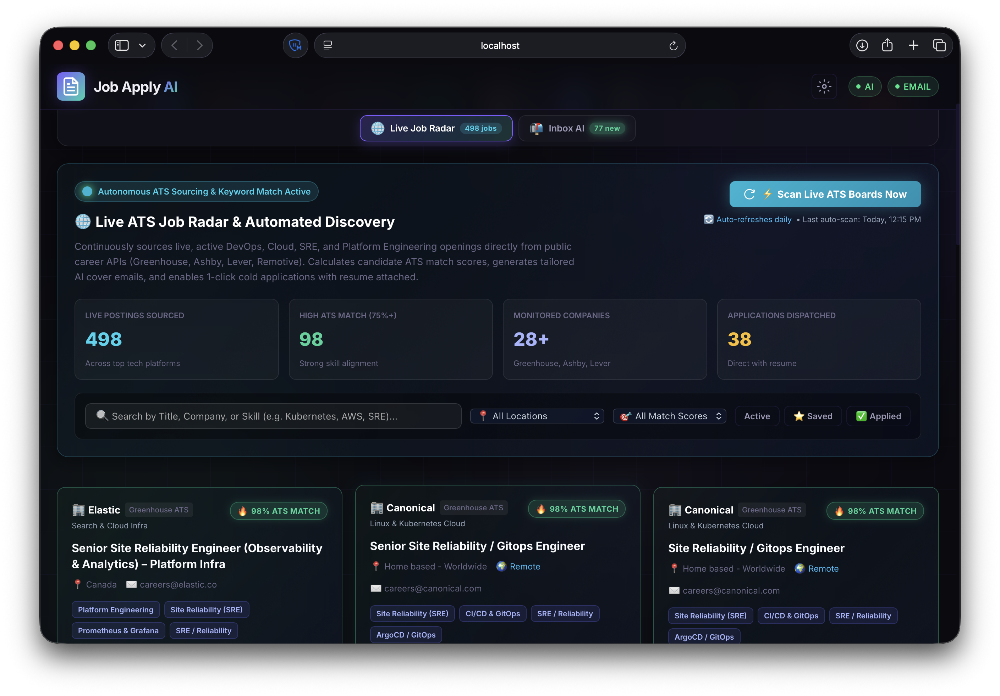
</p>

---

### 9. 👥 Recruiter Directories & Extracted Contact Pools
> Browse and filter pre-loaded databases of 3,400+ verified tech HR contacts alongside dynamic pools of leads extracted from your processed job postings.

| Curated Tech HR Directory | Extracted Job Posting Leads |
|:---:|:---:|
| 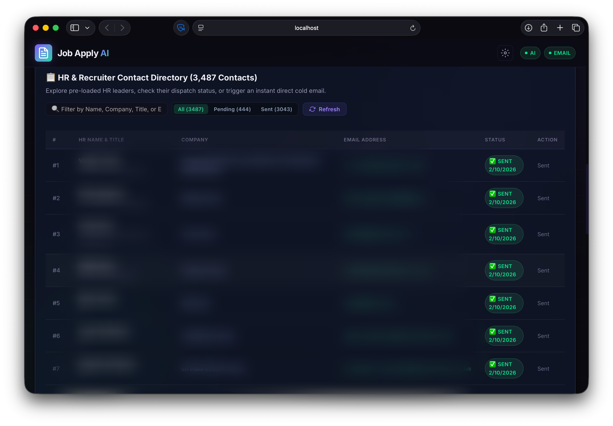 | 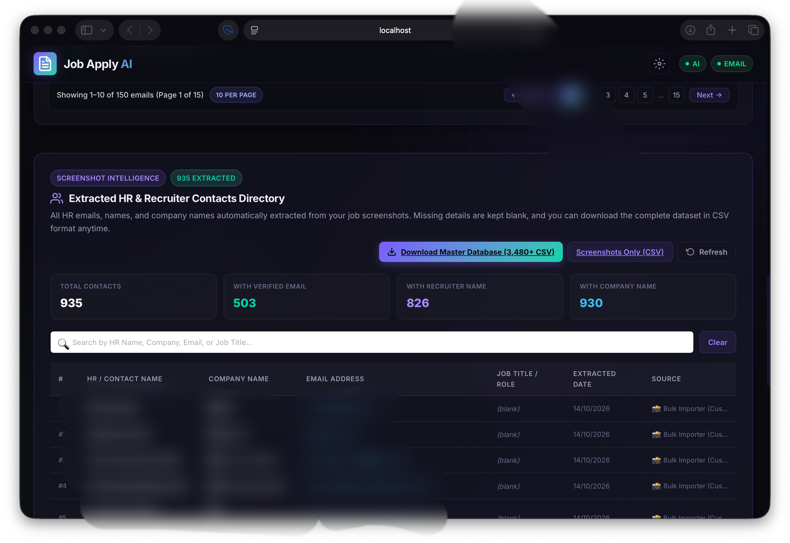 |

---

### 10. 📄 Sent Activity History with 10-Item Pagination
> Browse through your sent applications with smooth 10-per-page pagination and one-click detailed email inspection modals.

<p align="center">
  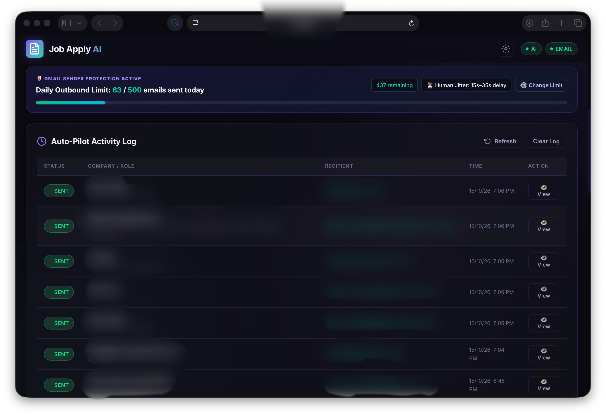
</p>

---

## 🌍 Built for Any Job Role & Candidate

Auto Job Apply AI is **100% customizable for any candidate and job domain**. Whether you are a **Full Stack Developer**, **Backend Engineer**, **DevOps / Cloud Specialist**, **Frontend Engineer**, **AI/ML Practitioner**, **Data Scientist**, **QA / SDET**, or in a **Custom Industry**, you can tailor your candidate profile, core technical strengths, custom AI pitch instructions, and signature in seconds.

---

## 🌟 Key Features

### 1. ⚙️ Universal AI Persona & Profile Customizer (8 Built-In Presets)
* **1-Click Role Presets**:
  * 🚀 **DevOps & Cloud Engineer** (AWS, Kubernetes, Terraform, Docker, CI/CD, Prometheus)
  * 💻 **Full Stack Developer** (React, Node.js, TypeScript, Next.js, PostgreSQL, MongoDB)
  * ⚙️ **Backend Engineer** (Distributed Systems, APIs, Python, Go, Java, Microservices, Redis)
  * 🎨 **Frontend / UI Engineer** (React, Next.js, TypeScript, Tailwind CSS, Core Web Vitals)
  * 🧠 **AI / ML Engineer** (LLMs, RAG, PyTorch, LangChain, OpenAI/Gemini APIs, Vector DBs)
  * 📊 **Data Scientist / Analyst** (Python, SQL, Pandas, Tableau, Predictive Modeling)
  * 🧪 **QA Automation / SDET** (Cypress, Playwright, Selenium, Postman, Jest)
  * 🛠️ **Custom Role** (Completely configurable for any domain)
* **Dynamic Custom AI Instructions**: Provide arbitrary guidance to the AI (e.g. *"Highlight my microservices experience, mention 4 years experience, note 15-day notice period"*).
* **Live AI Persona Preview**: See in real-time how the AI will introduce you in outbound cold emails.
* **Auto-Generated & Editable Signatures**: Clickable links, phone numbers, and professional formatting.

### 2. 📁 Universal Bulk Cold Outreach & Custom CSV Importer
* **Import Any Custom CSV File**: Drag & drop any CSV file from any source. The smart auto-detector automatically maps `Email`, `Name`, `Company`, `Role`, and `Phone / Number` columns.
* **Image OCR Contact Extractor**: Drop screenshots of emails, spreadsheets, or hiring lists to automatically extract valid email addresses and phone numbers via Google Gemini Vision.
* **Batch Staging & Live Queue**: Review staged recipients with phone numbers and email links before sending.
* **Live SSE Progress & Speed Control**: Real-time progress bar with adjustable dispatch speed (Conservative 15-30s, Balanced 8-15s, Rapid 3-7s) and instant pause/resume controls.

### 3. 🤖 Continuous Auto-Pilot Folder Watcher (Zero-Click)
* **Drop & Forget**: Simply save or drag job posting screenshots (PNG, JPG, WEBP, HEIC) into the `auto_jobs/` directory.
* **Real-Time Watcher**: Event-driven file system monitoring (`chokidar`) detects and processes incoming job postings in milliseconds.
* **Auto-Cleanup**: Automatically moves or removes processed screenshots after successful delivery to keep your workspace organized.

### 4. 🧠 Multimodal AI Vision & Resume-Context Ingestion
* **Deep OCR & Role Extraction**: Powered by Google Gemini Vision models (`gemini-2.5-flash` / `gemini-1.5-flash` with automatic fallback).
* **Multi-Screenshot Support**: Seamlessly analyzes long scrolling job postings spanning multiple screenshots.
* **Resume-Aware Personalization**: Ingests your uploaded PDF resume directly into the Gemini prompt to extract genuine work achievements, specific frameworks, and quantifiable metrics.

### 5. ✍️ Anti-AI Human Writing Engine
* **Zero Robotic Clichés**: Strict prompt constraints prevent dead giveaways like *"I am thrilled to apply"*, *"tapestry"*, *"beacon"*, *"invaluable asset"*, or *"proven track record"*.
* **Authentic Tone**: Concise (100–140 words), direct, and written engineer-to-engineer / professional-to-recruiter with live project links to your portfolio.

### 6. 📄 Auto-Pilot Activity Log with 10-Item Pagination
* **Clean 10-Email Pages**: Easily browse your sent application history 10 emails at a time.
* **Interactive Page Controls**: Jump between pages using `← Previous`, `Next →`, or direct page numbers (`1`, `2`, `3`...).
* **Detailed Inspection Modal**: Click **`👁️ View`** on any row across any page to inspect the full email body, recipient details, and timestamp.

### 7. 💬 Recruiter WhatsApp Outreach Pipeline
* **Mobile Number Extraction**: Automatically detects recruiter phone numbers from job screenshots (supports Indian standard 10-digit, `+91`, `0` prefixes, and international formats).
* **AI WhatsApp Pitch Generation**: Drafts concise, conversational WhatsApp messages (<90 words) tailored to the role.
* **1-Click WhatsApp Dispatch**: Preview, edit, and click **`🚀 Open in WhatsApp`** to launch WhatsApp Web/Desktop (`https://wa.me/...`) with prefilled outreach text.

### 8. 🛡️ Role-Aware Duplicate Protection & Quotas
* **Smart Recruiter Memory**: Distinguishes between applying to the same job vs. applying to multiple distinct openings posted by the same agency/recruiter.
* **Sender Reputation Guard**: Enforces daily send limits (default: 150/day, customizable via UI or `.env`) to safeguard Gmail accounts.
* **Dynamic Jitter**: Injects natural delays between emails to mimic human sending cadence.

### 9. 📬 Two-Way Inbox Intelligence & Auto-Reply Radar
* **Direct IMAP Inbox Listener**: Connects securely to your Gmail inbox to listen for incoming recruiter replies to your cold applications and follow-ups.
* **AI Sentiment & Intent Categorization**:
  * 🟢 **Interview Invitation**: Screening calls, technical rounds, Google Meet / Zoom invites.
  * 🌟 **Positive Interest**: Shortlisting notices, profile under hiring manager review.
  * ❓ **Information Requested**: Inquiries regarding notice period, current & expected CTC, location eligibility.
  * 🛑 **Rejection / Closed**: Position filled or location mismatch.
  * 🟡 **Out of Office (OOO)**: Auto-responders with extracted return dates.
* **Instant Auto-Stop Cadence**: Instantly removes any contact from the follow-up cadence once a reply or rejection is detected to avoid awkward follow-ups. Reschedules OOO follow-ups past the return date.
* **Live Audio & Desktop Alerts**: Synthesizes real-time audio chimes and native browser notifications when high-priority interview invitations are received.
* **1-Click Smart Reply Drafter**: Tailored reply generation with tone choices (Interview Availability, Professional, Direct CTC/Notice, Graceful) and one-click pre-filled Gmail compose dispatch.

---

## 🏗️ System Architecture

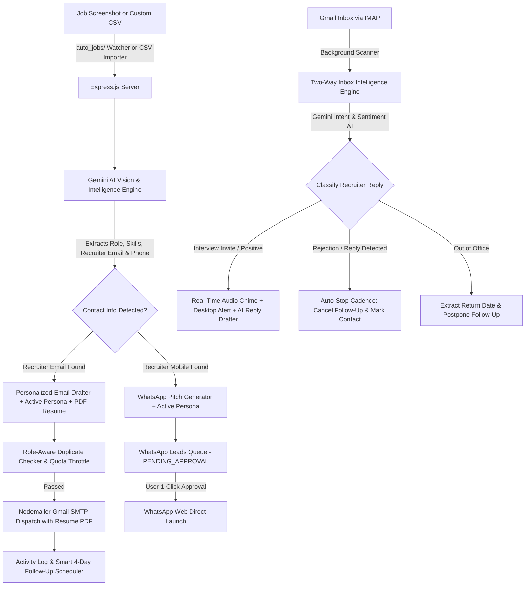

---

## 📖 Step-by-Step User Guide (Get Started in 5 Minutes)

### Step 1: Prerequisites
Make sure you have installed on your computer:
* **Node.js**: v18.0.0 or higher ([Download Node.js](https://nodejs.org/))
* **Git**: ([Download Git](https://git-scm.com/))
* **A Google Account**: To send emails via Gmail SMTP.

---

### Step 2: Clone the Repository & Install Dependencies
Open your terminal and run:
```bash
git clone https://github.com/ajayautade/auto-job-apply.git
cd auto-job-apply
npm install
```

---

### Step 3: Configure Environment Credentials
Create your `.env` configuration file from the provided template:
```bash
cp .env.example .env
```

Open `.env` in any text editor and fill in your details:

```env
# 1. Google Gemini API Key (Free tier available)
# Get your free key at: https://aistudio.google.com/apikey
GEMINI_API_KEY=your_gemini_api_key_here

# 2. Gmail SMTP Credentials
# Step A: Enable 2-Factor Authentication on your Google Account (https://myaccount.google.com/security)
# Step B: Generate an App Password at: https://myaccount.google.com/apppasswords
# Step C: Select "Mail" and copy the 16-character password into GMAIL_APP_PASSWORD
GMAIL_USER=your_email@gmail.com
GMAIL_APP_PASSWORD=xxxx xxxx xxxx xxxx

# 3. Your Candidate Profile Details
YOUR_NAME=Your Full Name
YOUR_TITLE=DevOps Engineer | Cloud & Platform Specialist
YOUR_EMAIL=your_email@gmail.com
YOUR_PHONE=+1 234 567 8900
YOUR_PORTFOLIO=https://yourportfolio.com
YOUR_LINKEDIN=https://linkedin.com/in/yourprofile
YOUR_GITHUB=https://github.com/yourusername

# 4. Outbound Quota & Jitter Limits
DAILY_SEND_LIMIT=150
MIN_JITTER_SECONDS=15
MAX_JITTER_SECONDS=35
FOLLOW_UP_DAYS=4

# 5. Server Port
PORT=3000
```

> [!IMPORTANT]
> **Never commit your `.env` file!** It is already included in `.gitignore` so your passwords and API keys stay completely private on your local machine.

---

### Step 4: Launch the Application
Run the start command in your terminal:
```bash
# Start the server
npm start

# Or start in development mode with live reload
npm run dev
```

Open your browser and navigate to:
```
http://localhost:3000
```

---

### Step 5: Upload Your Resume & Customize Your Profile
1. On the dashboard, switch to the **`⚙️ AI Persona & Profile`** tab.
2. Select your role preset (e.g., *DevOps & Cloud Engineer*, *Full Stack Developer*, *Backend Engineer*, etc.) or choose *Custom Role*.
3. Click **`Attach / Change Resume`** to upload your resume PDF. The app saves it locally in `public/uploads/resumes/` and will automatically attach it to every outbound application.
4. Customize your **Target Roles**, **Core Skills**, and **Custom AI Instructions** (e.g. highlight specific frameworks, years of experience, notice period, or portfolio projects).
5. Click **`Save Profile & Apply Changes`**.

---

### Step 6: Start Applying (Choose Your Mode)

#### Mode A: Autonomous Auto-Pilot (Zero-Click)
1. On the **Auto-Pilot** tab, note your watch folder path (by default: `./auto_jobs/`).
2. When browsing LinkedIn, Naukri, Indeed, or Wellfound, take a screenshot of a job posting (PNG, JPG, or HEIC) and save or drag it directly into the `auto_jobs/` folder.
3. The background watcher automatically detects the file, uses Gemini Vision to extract the recruiter email, customizes a cold email referencing your resume, attaches the PDF, and sends it via Gmail.
4. Check the **Auto-Pilot Activity Log** table to watch real-time delivery status.

#### Mode B: Bulk Cold Outreach & Custom CSV Import
1. Navigate to the **`📤 Bulk Cold Outreach`** tab.
2. Choose one of the 3 sourcing tabs:
   * **📁 Import Custom CSV File**: Drag & drop any CSV containing company/recruiter contacts. The smart column mapper automatically identifies `Email`, `Name`, `Company`, and `Phone`.
   * **🖼️ Extract from Image / Screenshot**: Upload an image containing emails or phone numbers to have Gemini OCR extract all contacts.
   * **📋 Curated Database**: Use the pre-loaded tech company database.
3. Review the staged contacts table (complete with phone numbers and email addresses).
4. Customize the subject line and pitch template if desired.
5. Click **`🚀 Dispatch Cold Emails to Staged Contacts`** and watch the live progress bar.

#### Mode C: Manual Screenshot Upload
1. Switch to the **`✍️ Manual Upload`** tab.
2. Drag and drop single or multiple screenshots of a job posting.
3. Click **`Analyze Job Posting`** to inspect the extracted company, role, and recruiter contact.
4. Review or edit the drafted cold email, verify your attached resume, and click **`Send Application`**.

#### Mode D: WhatsApp Recruiter Outreach
1. Switch to the **`💬 WhatsApp Outreach`** tab.
2. If a recruiter listed a mobile number in the job post, an AI-tailored WhatsApp pitch will appear under **Pending Leads**.
3. Review the message and click **`🚀 Open in WhatsApp`** to launch WhatsApp Web/Desktop with the pre-filled message ready to send.

---

### Step 7: Browse Sent History with Pagination
* Under **Auto-Pilot Activity Log**, your sent outreach is automatically paginated **10 emails per page**.
* Use the **`Next →`**, **`← Previous`**, and numbered page buttons to navigate your outreach history.
* Click **`👁️ View`** on any row to view the full email text, recipient, and timestamps in a popup modal.

---

## 🔒 Privacy & Security Protections

This repository has strict privacy safeguards built-in:
* **All Private Data Gitignored**:
  * `.env` (API keys, Gmail app passwords)
  * `*.csv`, `*.csv.bak`, `*.tsv`, `*.xlsx` (Private contact lists and company databases)
  * `*.pdf`, `*.docx`, `*.doc` (Your personal resumes)
  * `user_profile.json` (Local candidate profile data)
  * `auto_jobs/` runtime files (Processed screenshots, history logs, recruiter leads)
  * `scratch/` & `.kilo/` (Temporary debug files)
* **Safe SMTP Authentication**: Connects using Google's 16-character App Passwords with TLS encryption; your main account password is never stored or transmitted.

---

## 🛠️ Technology Stack

* **Backend**: Node.js, Express.js, Nodemailer
* **Vision & AI**: Google Gemini AI API (`@google/genai`)
* **File Watcher**: Chokidar
* **Frontend**: Vanilla JavaScript (ES6+), Modern Glassmorphic CSS Design System, Responsive HTML5
* **Security & Reliability**: In-memory and file locks, rate-limiting jitter, RFC-4180 CSV parser, automated backup rotation

---

## 📜 License

MIT License © 2026. Built with passion for software engineers, developers, and job seekers everywhere.
